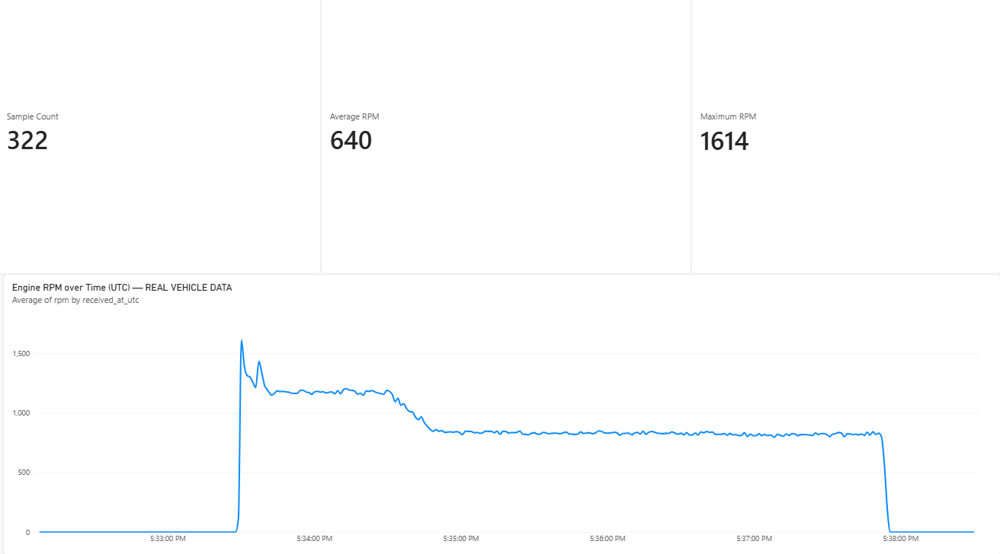

# Vehicle Telemetry — IIoT Proof of Concept

A small learning project using vehicle engine RPM to demonstrate equipment data acquisition, Python validation, SQL storage and Power BI reporting.

## Data flow

ELM327 OBD-II adapter → ESP32 over Bluetooth Classic → USB serial → Python → SQLite → CSV → Power BI.

The ESP32 requests engine RPM with OBD-II command `010C`. Python validates the received uptime and RPM, adds a UTC reception timestamp and saves each valid reading. SQL queries summarize the measurements. Power BI imports the exported CSV.

## Recorded data

The included real-vehicle dataset contains 322 readings recorded on 11 October 2026, from 17:32:07.787 to 17:38:29.946 UTC.

| Metric | Value |
|---|---:|
| Samples | 322 |
| Average RPM, including engine-off samples | 639.64 |
| Maximum RPM | 1614 |
| Samples with RPM above zero | 224 |
| Average RPM above zero | 919.48 |

The dashboard displays the overall average rounded to 640. SQL results and the included CSV match the database.



## Files

- `obdesp32/obdesp32.ino`: ESP32 firmware.
- `collector.py`: validate serial readings and save them in SQLite.
- `analyze.py` and `queries.sql`: read-only SQL analysis.
- `export_csv.py`: export readings to CSV.
- `requirements.txt`: Python dependency.
- `telemetry.db` and `telemetry.csv`: the recorded dataset and its export.
- `vehicle_telemetry_dashboard.pbix`: Power BI report.
- `dashboard_real.png`: dashboard screenshot.

## Python setup (Windows)

```bat
py -m venv .venv
.venv\Scripts\python.exe -m pip install -r requirements.txt
```

SQLite is included with Python. Analyze the provided data without connecting hardware:

```bat
.venv\Scripts\python.exe analyze.py
```

Export after collecting new readings:

```bat
.venv\Scripts\python.exe export_csv.py
```

## Collect new measurements

1. Connect the ELM327 adapter to the vehicle and ESP32 to the laptop.
2. Configure the adapter Bluetooth address and PIN in the firmware for your hardware, then upload it with Arduino IDE. Use an ESP32 supporting Bluetooth Classic.
3. Close Arduino Serial Monitor and disconnect other devices using the adapter.
4. Find the USB serial port:

```bat
.venv\Scripts\python.exe -m serial.tools.list_ports
```

5. Start collection, replacing COM5 if needed:

```bat
.venv\Scripts\python.exe collector.py --port COM5
```

Press Ctrl+C to stop. New readings are appended to `telemetry.db`; export again to update the CSV.

## Power BI

Open `vehicle_telemetry_dashboard.pbix`. In Power Query, check that the Source step points to `telemetry.csv` in your local project folder, then apply changes and refresh. The imported table is named `telemetry`. The provided screenshot shows the 322-record dataset.

The report contains sample count, average RPM, maximum RPM and an RPM time-series chart. CSV import requires manual refresh; this is not a live dashboard.

## Validation and limitations

The included SQLite databases and CSV exports were checked for consistency. SQL analysis was run successfully and dashboard summary values match the recorded dataset. Python syntax was checked. Hardware acquisition and Power BI refresh must be checked on the local laptop after changes; they cannot be reproduced without the hardware and Power BI Desktop.

This is an equipment-data proof of concept, not a deployed factory platform. It uses SQLite, not MS SQL Server. Only RPM is collected. Alerts and PLC integration are not implemented. `received_at_utc` is the laptop reception time, not the vehicle sensor timestamp. ESP32 uptime resets when the board restarts.

If serial connection fails, check the COM port and close other applications using it. If the ESP32 reports a brownout, check its power supply and USB connection. Missing OBD responses are skipped rather than stored as zero RPM.
